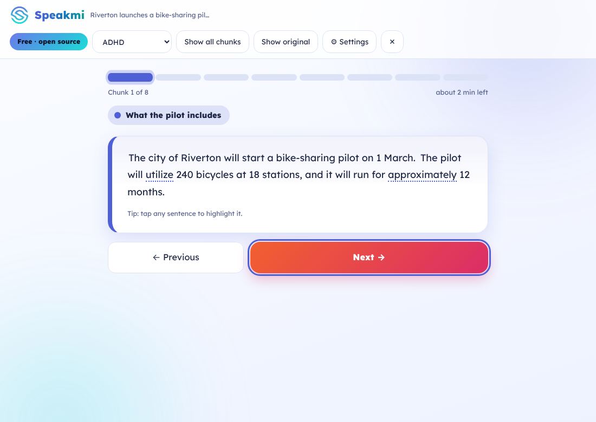
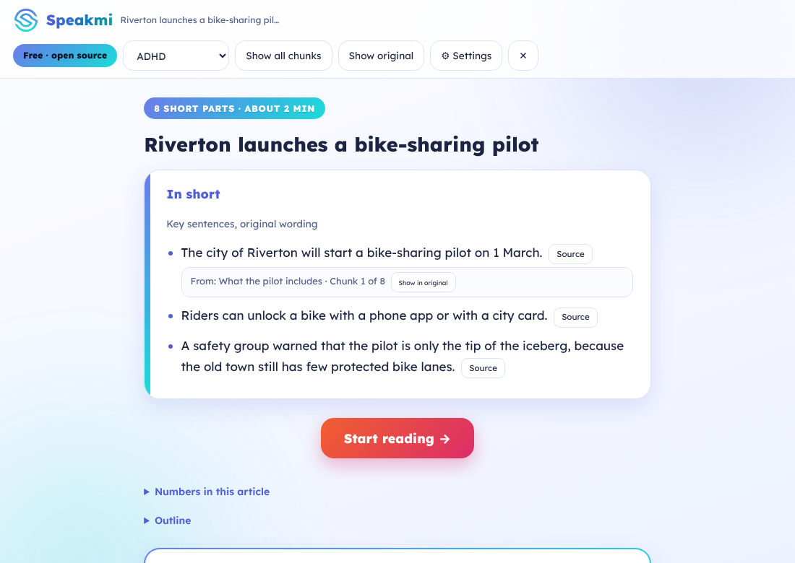
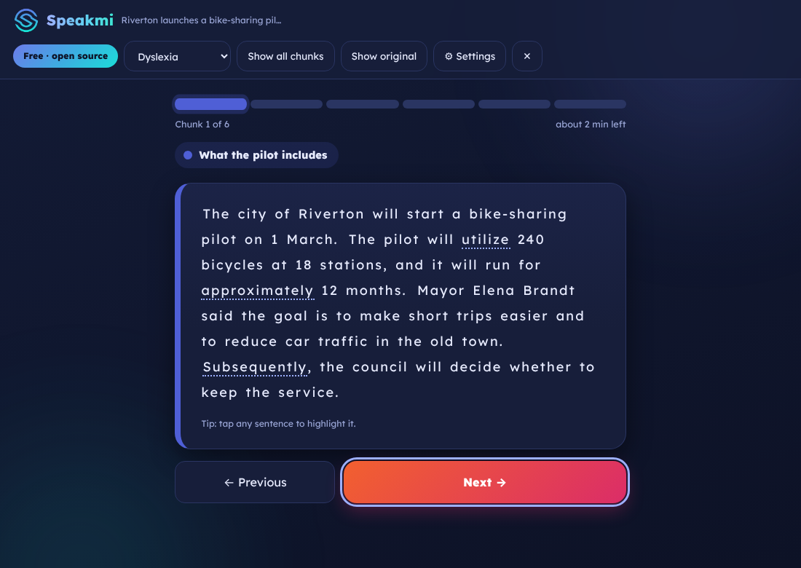

# Speakmi

**Open-source reading support for people with ADHD, dyslexia and autism.** Speakmi is a Firefox extension that turns a long web article into short, calm parts, and every point links back to the exact sentence it came from. It runs entirely on your device: no account, no server, no tracking.

Website and signed download: <https://ext.speakmi.com> · Licence: [MPL-2.0](LICENSE)

| Focus reading | Source anchoring | Dyslexia spacing |
|---|---|---|
|  |  |  |

## What it does
- Splits an article into short parts under its own headings, one at a time, with progress and reading time.
- Shows key sentences in the article's **original wording**, each with a **Source** button that opens the original text with that sentence highlighted.
- Five reading profiles: ADHD, dyslexia, autism-literal, mixed, general (chunk size, spacing, literal-language help).
- Flags figures of speech with their literal meaning and offers simpler-word hints (English, German, Bahasa Indonesia).
- Checks numbers, names and negations against the source before any rewritten text is shown ([how](docs/FIDELITY.md)).
- Labels every feature with how strong its evidence is (`content/evidence.js`) and keeps weak ones off by default.

## Human-Scale AI
| Principle | In this project |
|---|---|
| **Small** | The core uses no machine-learning model. Key sentences and chunks are extractive and the checks are plain rules, so it runs on any computer. Speakmi trains, ships and hosts no model. An optional, off-by-default plain-language rewriter runs one small model (currently about 0.08 billion parameters) inside Firefox's own on-device AI runtime; every rewrite is checked and falls back to the original sentence. |
| **Intentional** | Everything stays on the reader's device. The extension makes no network requests (enforced by `npm run check`), needs no account, and the code is open. The AI feature needs an explicit permission and an explicit switch; if the model is not cached, Firefox downloads it once. |
| **Tailored** | Designed for readers who are easily overloaded, with profiles, literal-language support and community-extensible language packs. Co-design and a validation pilot are planned ([protocol](docs/pilot/PROTOCOL.md)). |

Details and honest gaps: [docs/HUMAN-SCALE-AI.md](docs/HUMAN-SCALE-AI.md).

## Install
**Signed build:** download from <https://ext.speakmi.com> (or the latest GitHub release) and open the `.xpi` in Firefox 140 or newer.

**From source:**
```
git clone <this repository>
cd speakmi
node tools/build.js          # creates dist/firefox
```
Then open `about:debugging#/runtime/this-firefox`, choose **Load Temporary Add-on**, and select `dist/firefox/manifest.json`. Requires Node 18 or newer; the extension itself has no dependencies.

## Develop
```
npm run check     # syntax, licence headers, manifest, and a guard against network APIs
npm run build     # build the Firefox package
npm run test:ai   # AI client, gate and background handler (no dependencies; runs in CI)
npm install && npm test   # also the DOM tests (need jsdom; not part of CI yet)
node tools/eval-rewriter.js eval/smoke-test.jsonl   # score model outputs with the same gate
```
Architecture: [docs/ARCHITECTURE.md](docs/ARCHITECTURE.md). Roadmap: [docs/ROADMAP.md](docs/ROADMAP.md).

## Status
Beta (0.5.3). Not yet validated in a study; a first pilot with four adults is reported in [docs/pilot](docs/pilot/RESULTS.md) (it covered the extractive core, not the AI rewriter). The AI rewriter is integrated and unit-tested but **not yet evaluated** on real text ([protocol](docs/AI-EVALUATION.md)). The Firefox Add-ons listing is not live yet.

## Contribute
The most useful contributions are **new languages** (idioms with literal meanings, simpler words, sentence rules), **real-world test articles**, and **evaluating small models for the Firefox rewriter** ([docs/AI-EVALUATION.md](docs/AI-EVALUATION.md)). See [CONTRIBUTING.md](CONTRIBUTING.md). Please follow the [Mozilla Community Participation Guidelines](CODE_OF_CONDUCT.md).

## Licence and credits
MPL-2.0. Third-party components are listed in [THIRD_PARTY.md](THIRD_PARTY.md). Contact: hello@speakmi.com
